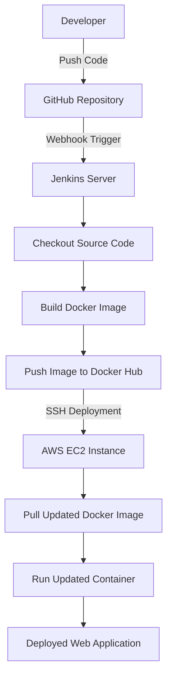
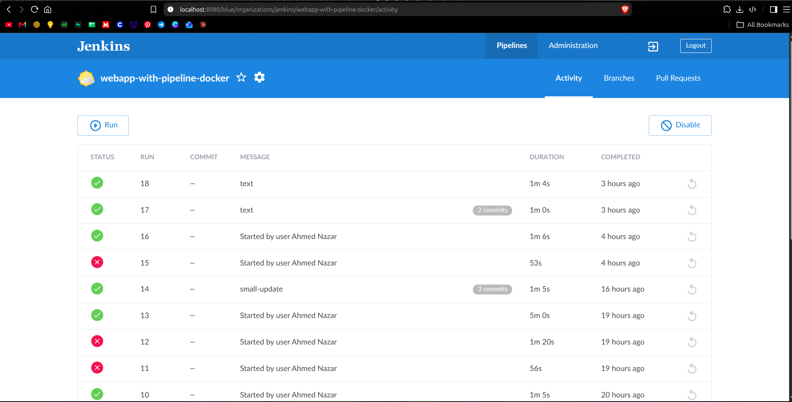
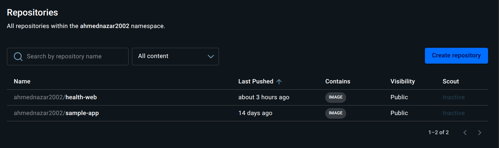
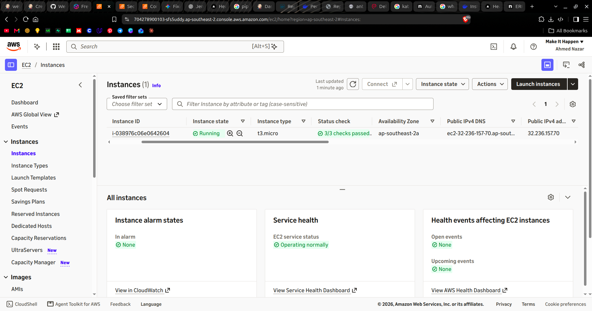
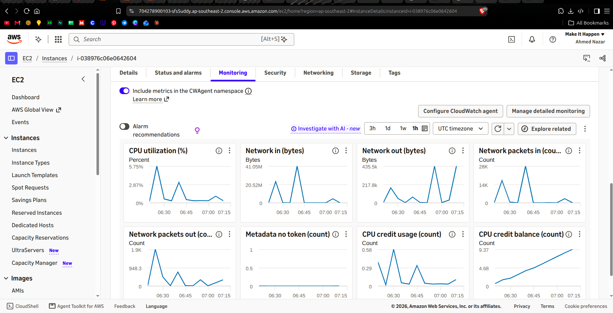
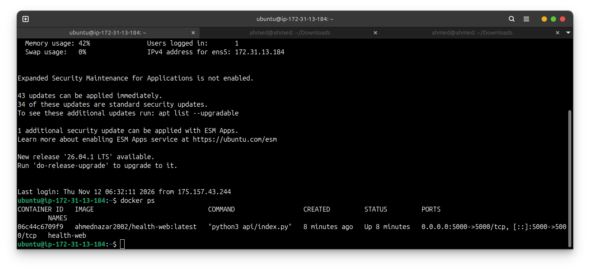
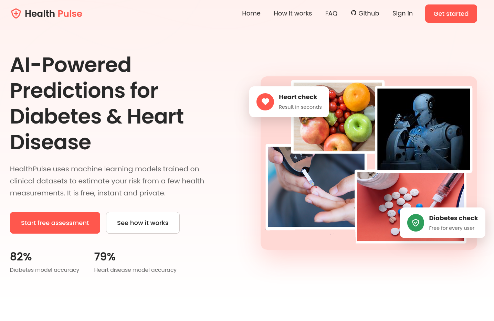
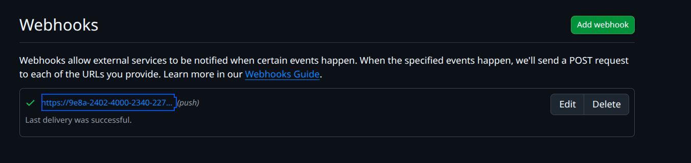

# Automated CI/CD Pipeline for a Python Web Application

**Jenkins | Docker | Docker Hub | AWS EC2 | GitHub**

## Project Overview

This project demonstrates the implementation of an automated Continuous Integration and Continuous Deployment (CI/CD) pipeline for an existing Python Flask web application.

The pipeline automates the process of retrieving application source code from GitHub, building a Docker image, publishing the image to Docker Hub, and deploying the updated application to an AWS EC2 instance.

The primary focus of this project is to gain practical experience with DevOps tools, CI/CD automation, containerization, remote server management, and cloud deployment.

**Note:** The Flask application used in this project is an existing application developed by another contributor. My work focuses on the DevOps implementation and deployment automation, not the original application development.

## Architecture

The following diagram illustrates the automated deployment workflow.

## Technologies Used

| Technology | Purpose |
|---|---|
| Git | Version control |
| GitHub | Source code management |
| GitHub Webhooks | Automatic pipeline triggering |
| Jenkins | CI/CD pipeline automation |
| Docker | Application containerization |
| Docker Hub | Docker image registry |
| AWS EC2 | Cloud deployment environment |
| Linux / Ubuntu | Server administration |
| SSH | Secure remote server access |
| ngrok | Temporary public access to locally hosted Jenkins for webhook integration |

## CI/CD Pipeline Workflow

### 1. Source Code Management

- Application source code is maintained in a GitHub repository.
- Git is used for version control.
- GitHub Webhooks notify Jenkins when changes are pushed to the repository.

### 2. Automated Pipeline Trigger

- Jenkins receives webhook notifications from GitHub.
- A new pipeline execution is triggered automatically.
- Jenkins retrieves the latest source code from the repository.

### 3. Docker Image Build

- Jenkins uses the application's Dockerfile to build a Docker image.
- The image packages the application and its required runtime environment.
- This ensures a consistent environment for deployment.

### 4. Docker Hub Integration

- Jenkins authenticates with Docker Hub using securely stored Jenkins credentials.
- The newly built Docker image is tagged and pushed to the Docker Hub repository.
- The published image becomes available for deployment on the remote server.

### 5. AWS EC2 Deployment

- Jenkins establishes an SSH connection to the AWS EC2 instance using key-based authentication.
- The EC2 instance pulls the updated Docker image from Docker Hub.
- The previous application container is replaced with a new container running the updated image.

### 6. Application Deployment

- The application runs inside a Docker container on the EC2 instance.
- The deployed application can be accessed through the EC2 public IP address and configured application port.

## Project Screenshots

The following screenshots demonstrate the major components of the implementation.

### 1. Jenkins CI/CD Pipeline

*Successful Jenkins pipeline execution.*

### 2. Docker Hub Repository

*Docker image published to Docker Hub.*

### 3. AWS EC2 Instance

*Running AWS EC2 deployment instance.*

### 4. Docker Container on EC2

*Application container running on the remote EC2 instance.*

### 5. Deployed Web Application

*Python web application successfully deployed and accessible through the EC2 instance.*

### 6. GitHub Webhook Integration

*GitHub webhook configuration used to trigger Jenkins automatically.*

## Infrastructure Configuration

### Jenkins Server

- Jenkins installed and configured on an Ubuntu environment.
- Docker installed for image building.
- GitHub integration configured.
- Docker Hub credentials managed through Jenkins Credentials.
- SSH credentials configured for remote deployment.

### AWS EC2 Deployment Server

- EC2 instance running Linux.
- Docker installed and configured.
- SSH access enabled for remote administration.
- Security group configured to allow the required network traffic.
- Application deployed as a Docker container.

## Jenkins Credentials Management

Sensitive credentials are managed using Jenkins Credentials instead of hardcoding them into the pipeline.

Credentials used include:

- Docker Hub authentication credentials.
- SSH private key for remote EC2 deployment.
- GitHub credentials, where repository access requires authentication.

Passwords, private keys, and access tokens should never be committed to the source code repository.

## Key DevOps Concepts Practiced

- Continuous Integration and Continuous Deployment.
- Jenkins pipeline automation.
- GitHub webhook integration.
- Docker image building and management.
- Container registry integration.
- Secure credential management.
- SSH key-based authentication.
- Remote Linux server administration.
- AWS EC2 configuration and deployment.
- Automated application deployment.

## Future Improvements

Potential improvements to this project include:

- Implementing Nginx as a reverse proxy.
- Configuring HTTPS using SSL/TLS.
- Using AWS Elastic Container Registry (ECR) as an alternative image registry.
- Implementing Terraform for infrastructure provisioning.
- Using Ansible for server configuration management.
- Introducing Docker image versioning and rollback mechanisms.
- Implementing application health checks and monitoring.
- Improving deployment security and reliability.

## Application Source & Attribution

This project uses the **HealthPulse** Python Flask application as the sample workload for implementing and demonstrating the CI/CD pipeline.

The original application was developed by **therituraj** and is distributed under the MIT License.

- **Original Developer:** therituraj
- **Original Repository:** [HealthPulse - GitHub](https://github.com/therituraj/HealthPulse)
- **License:** MIT License

The original application source code is not my original work. My contribution focuses on the DevOps implementation, including:

- Jenkins CI/CD pipeline automation.
- Docker configuration and image building.
- Docker Hub integration.
- SSH-based remote deployment.
- AWS EC2 deployment and infrastructure configuration.

The original application's ownership and copyright remain with its respective author. The original MIT License and copyright notices are retained.

Please refer to the original repository and its LICENSE file for the application's licensing terms.

## Author

**Ahmed Nazar**

BICT (Hons) Undergraduate  
University of Kelaniya

Interested in Cloud Computing, DevOps Engineering, Linux Administration, Automation, and Infrastructure Management.
